

  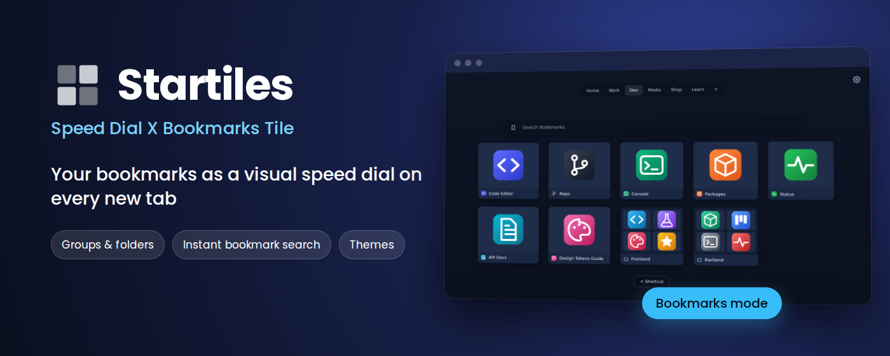

  
  
  
  
  

  <b>A Speed Dial new tab for Chromium browsers.</b> 
  Groups, thumbnail tiles, folders, themes and instant bookmark search. 
  Your dials are stored as ordinary bookmarks.

  

  <a href="#-install">Install</a> ·
  <a href="#-two-modes">Two modes</a> ·
  <a href="#-features">Features</a> ·
  <a href="#-screenshots">Screenshots</a> ·
  <a href="#-keyboard">Keyboard</a> ·
  <a href="#-settings">Settings</a> ·
  <a href="#-backup--reset">Backup & reset</a> ·
  <a href="#-data--privacy">Data & privacy</a> ·
  <a href="#-support">Support</a>

## ✨ Highlights

<table>
  <tr>
    <td width="33%" valign="top"><b>🗂️ Groups & folders</b> Switch groups with a swipe, nest folders as deep as you like, reorder everything by drag & drop.</td>
    <td width="33%" valign="top"><b>🔎 Instant bookmark search</b> Type and the tiles of all groups and folders are filtered by title and address.</td>
    <td width="33%" valign="top"><b>🎨 Themes</b> Auto, Light, Dark, Midnight, Sand &ndash; or build and save your own.</td>
  </tr>
  <tr>
    <td valign="top"><b>🖼️ Smart thumbnails</b> Site icon, logo, page preview, your own image or file, with hi-res icons and automatic refresh.</td>
    <td valign="top"><b>✨ Smooth animations</b> Folders grow from the tile, tiles slide into place, seven deletion effects. All can be switched off.</td>
    <td valign="top"><b>💾 Yours to keep</b> Dials are ordinary bookmarks, so your browser's own sync can carry them along. Selective Export / Import and Reset.</td>
  </tr>
</table>

## 🚀 Install

**From the Chrome Web Store (recommended):** open the [Startiles page in the Chrome Web Store](https://chromewebstore.google.com/detail/startiles-speed-dial-x-bo/pjnkboombbeajiakdfghhpgonlcliknm) and click **Add to Chrome**. Edge, Brave, Vivaldi, Opera and other Chromium browsers can install it from the same page. Updates arrive automatically.

**From source (for developers):**

1. Download or clone this repository.
2. Open `chrome://extensions` and enable **Developer mode**.
3. Click **Load unpacked** and select this folder.

`edge://extensions`, `brave://extensions` and the like work the same way. After updating the files press **Reload** on the extension card.

## 🧭 Two modes

On the very first start (and again after *Reset to Default → Settings*) a window asks where your tiles should live. You can change it any time with the **Mode** list in Quick Settings or in **Advanced Settings → Mode**. The window for choosing the root bookmarks folder appears when you switch to Bookmarks for the first time (or when the folder chosen earlier no longer exists); afterwards the mode just switches back, and **Choose root folder…** changes the folder.

<table>
  <tr>
    <td width="50%" valign="top">
      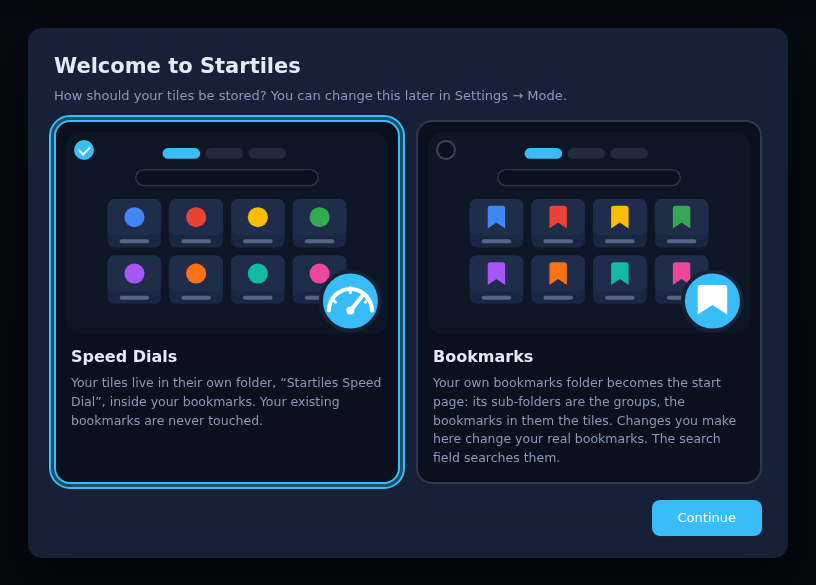
    </td>
    <td width="50%" valign="top">

|  | ⏱️ **Speed Dials** | 🔖 **Bookmarks** |
|---|---|---|
| Tiles live in | their own folder, *Startiles Speed Dial* | a bookmarks folder you choose |
| Groups are | sub-folders of that folder | sub-folders of your folder |
| Your bookmarks | never touched | shown as the start page; renaming, deleting and moving change them |
| Search field | the engine you picked | set to **Bookmarks** (change it any time) |

</td>
  </tr>
</table>

> [!NOTE]
> The window cannot be dismissed and nothing is created in your bookmarks before you answer.

## 🧩 Features

### Browse & organise
- **Groups bar** on top: switch groups (the tiles swipe left or right depending on the direction), drag to reorder, right-click or double-click to rename or delete, `+` to add. Many groups wrap into several rows; the maximum width is configurable.
- **Tiles**: link tiles and folders. A folder thumbnail is a 2×2 grid of its first four tiles. Hover a tile for the edit (✎) and delete buttons.
- **Drag & drop**: reorder tiles; drop a tile on another one to create a folder, on a folder to move it inside, on a group tab to move it to that group.
- **Folders** open as an animated window that grows from the tile and collapses back, and can contain folders. Enter with a click or `Enter`, leave with the back arrow, `Backspace`, the mouse Back button or the browser Back. Close with a click outside, `Esc` or ×. Dragging a tile onto the dimmed area moves it out to the current group.
- **Toolbar button**: a left click on the extension icon opens the Speed Dial in a new tab of the current window.

### Search
- Pick your favourite search engine from a list of popular ones, with optional query suggestions. Typing an address opens it directly.
- The **Bookmarks** engine is not a web search: while you type, the tiles of all groups (and their folders) are filtered by title and address. `Enter` opens the first match, `Esc` or the **×** in the field clears it, a click on a group tab leaves the results.

### Thumbnails
The **Add / Edit** dialog has an address with autocomplete (bookmarks, history, popular sites), a title, and the thumbnail:

| Mode | What you get |
|---|---|
| **Automatic → Icon** | The site icon on a coloured background. If the site has several square icons they appear as a picker with pixel sizes. |
| **Automatic → Logo** | A wide (rectangular) logo of the site, found automatically: the wide Windows tile image (`msapplication-wide310x150logo` and `browserconfig.xml`), the `logo` of the site's JSON-LD markup, `og:logo`, the logo image in the page header, and the wide icons the page declares. Every candidate is downloaded and must really be wide (at least 1.5:1). A picker lists all the wide variants that were found; if the site has none, the regular icon is shown. It is shown 1.6 times as wide as a square icon and follows the Icon Size setting. When the site has no suitable logo, **Search online** looks on Wikidata and Wikimedia Commons (only when you press the button; the site name is sent to those services), and **Google Images ↗** opens an image search for wide, transparent logos: copy an image there and press `Ctrl+V` in the dialog (an image address pasted outside the text fields works too) and it is used as a wide icon. |
| **Automatic → Pageview** | A screenshot taken when you visit the page, otherwise the page's `og:image`, otherwise the icon. |
| **Image URL** / **Local file** | Your own picture. Fit: *Fill*, *Fit inside*, *Icon size* (shown at the same size as site icons, following the Icon Size setting) or *Logo size* (like a wide site logo). The Fit you used last is preselected next time. |

Uploaded images are scaled down so that their shorter side is at most 420 px (smaller ones are kept as they are). Long titles get a caption with the full text when they do not fit into the tile (can be switched off).

### Look & motion
- **Themes**: Auto (follows the browser's light / dark mode), Light, Dark, Midnight (deep navy, cyan accent), Sand (warm paper, terracotta accent) and your own custom themes. The colours are grouped as Page, Tiles, Text & Accent, Panels & Controls, and the folder window colour follows the page colour by default.
- **Tile deletion** plays an animation of your choice, with a live preview: *Fade and shrink, Pop, Dissolve, TV off, Shatter, Disintegrate* (default) *and Poof*.
- **Tile shift**: after a deletion or a move the other tiles slide smoothly into their new places.
- **Settings → Behavior → Animations**: *Auto* (default) shows animations only when the browser's hardware acceleration is on, *ON* always, *OFF* never. In *Auto* a line tells whether acceleration is ON or OFF. Each animation also has its own switch.

## 📸 Screenshots

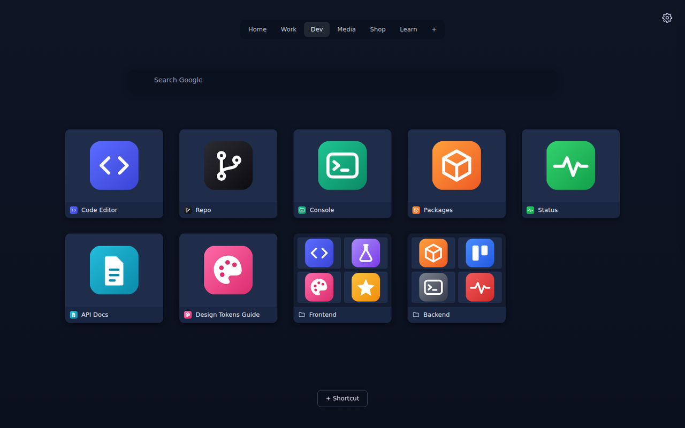

<table>
  <tr>
    <td width="50%" valign="top">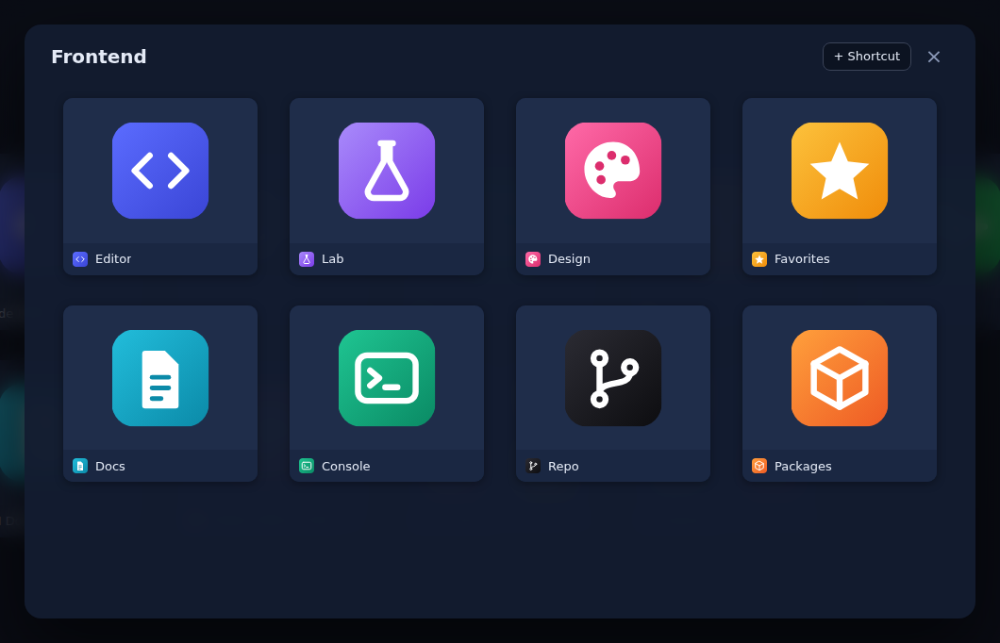 <b>Folders</b> open as a window that grows from the tile.</td>
    <td width="50%" valign="top">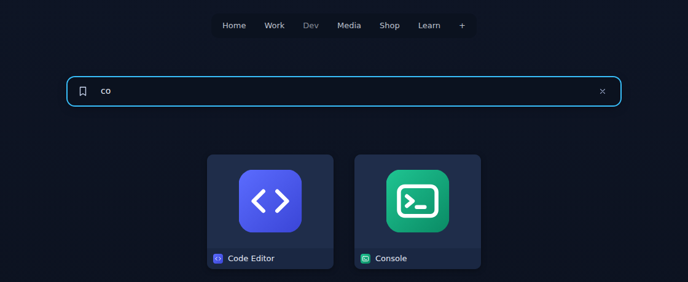 <b>Bookmark search</b> filters all groups while you type.</td>
  </tr>
</table>

<table>
  <tr>
    <td width="50%" valign="top"> <b>Midnight</b></td>
    <td width="50%" valign="top">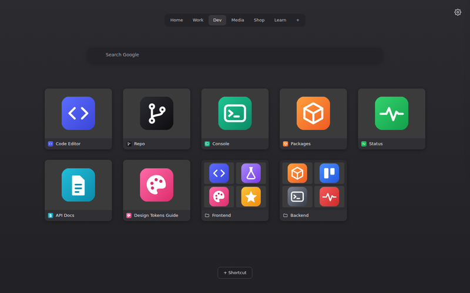 <b>Dark</b></td>
  </tr>
  <tr>
    <td valign="top">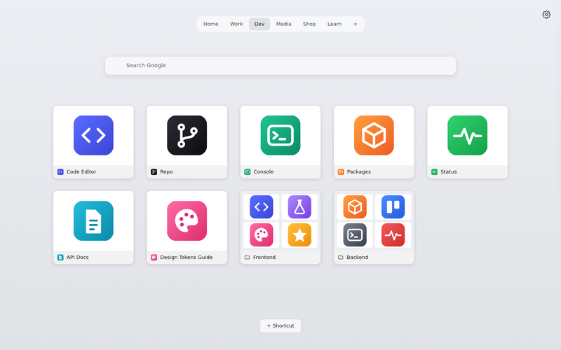 <b>Light</b></td>
    <td valign="top">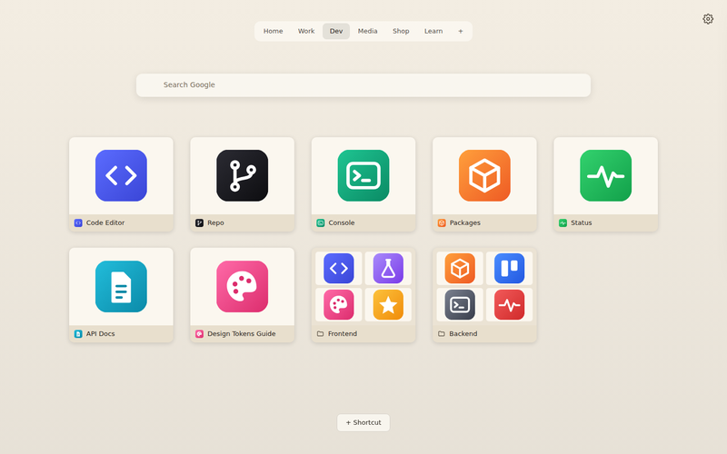 <b>Sand</b></td>
  </tr>
</table>

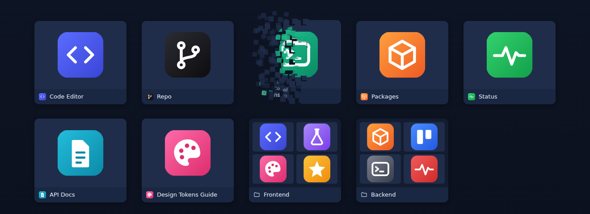
<b>Disintegrate</b> &ndash; one of seven deletion animations; the neighbours then slide into place.

<table>
  <tr>
    <td width="50%" valign="top">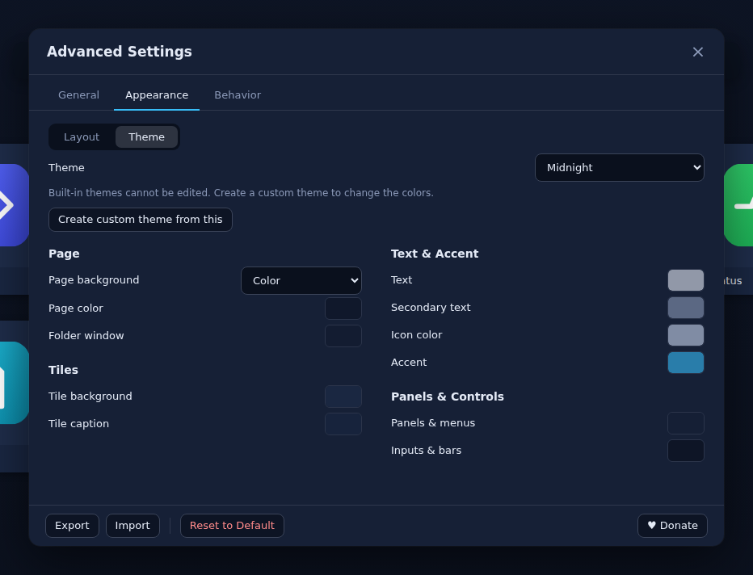 <b>Theme</b> editor in Advanced Settings.</td>
    <td width="50%" valign="top">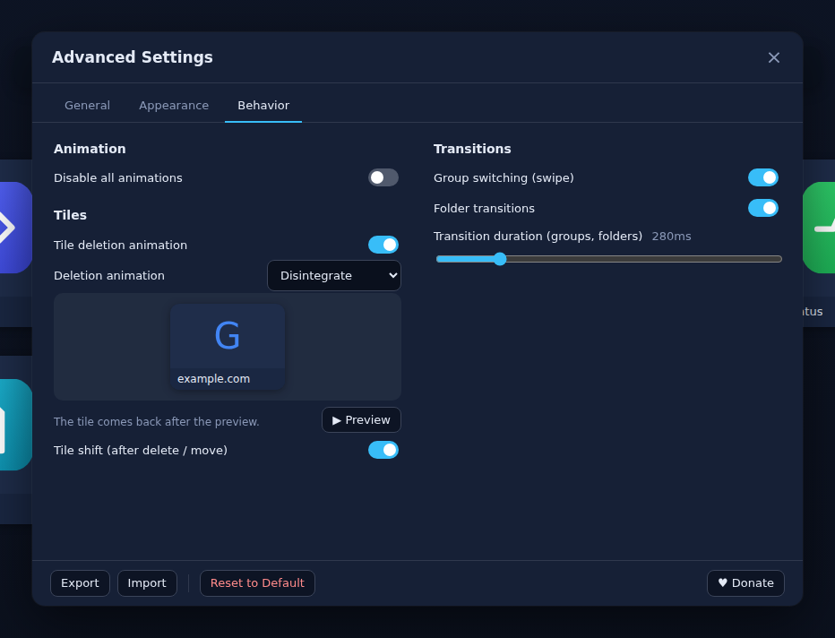 <b>Behavior</b>: animations with a live preview.</td>
  </tr>
</table>

## 🎹 Keyboard

**Tab order** (cyclic): Group bar → Search field → Dials → + Shortcut → Settings → Group bar. `Shift+Tab` goes the other way. After opening a new tab the focus is in the address bar; the first `Tab` moves it to the Group bar. Empty or hidden parts are skipped. While a folder is open, `Tab` cycles inside its window: back arrow → tiles → + Shortcut → ×. An arrow key pressed while a button (for example **+ Shortcut**) has the focus moves the highlight to the tiles, and `Tab` / `Shift+Tab` continue from there.

<b>All keys</b>

| Where | Key | Action |
|---|---|---|
| Group bar | `←` `→` | Previous / next group (selects it, the tiles swipe); `Home` / `End` – first / last |
| Group bar | `↑` `↓` | Row above / below when the groups wrap into several rows |
| Group bar | `Enter` / `Space` on `+` | Create a group |
| Dials | `←` `→` `↑` `↓` | Move the highlight over the tiles (of the page, or of the open folder) |
| Dials | `Home` / `End` | First / last tile |
| Dials | `Enter` / `Space` | Open the highlighted folder or follow the highlighted link (`Ctrl`/`Cmd`/`Shift` + `Enter`/`Space` behave like clicking with that key) |
| Folder | `Backspace` | Leave the inner folder (one level back) |
| Folder | `Esc` | Close the folder |
| Settings | `Enter` / `Space` | Open Quick Settings (the focus moves into it); `Esc` closes it and returns to the gear |

The highlighted group, field and buttons get a focus ring, the highlighted tile an accent frame. Using the mouse hides the tile highlight; arrow keys do nothing while you type in a field or a dialog is open.

## 🔧 Settings

**Quick Settings** (the gear icon): mode (Speed Dials / Bookmarks), theme, search engine, tile size, ratio, maximum columns, icon size, and the **Advanced Settings…** button.

**Advanced Settings** is a movable window with three tabs: **General**, **Appearance** (Layout / Theme) and **Behavior**. It closes on a click outside or `Esc`.

<b>Every option</b>

| Category | Options |
|---|---|
| Mode | Speed Dials / Bookmarks; **Choose root folder…** (Bookmarks mode); path of the root folder. Each mode remembers its own search engine and brings it back when you switch (in Bookmarks mode it starts as *Bookmarks*) |
| Start Page | Theme; search engine (incl. Bookmarks); search suggestions; page background Color / URL / Image |
| Icons & Previews | Try to fetch hi-res icons & previews; **Auto-refresh** icons & previews once a day / week / month (default) / year, refresh site icons now |
| Groups Bar | Top offset; max width in px and in % of the window |
| Search Field | Show / hide; top offset |
| Speed Dial Grid | Top offset, max columns, horizontal and vertical gaps |
| + Shortcut Button | Show / hide; anchor (bottom of page / below tiles); offset |
| Tiles | Tile size, W:H ratio (1-1.8), tile corner size, icon size in %, tile titles, long-title caption, delete button |
| Folder Window | Size in % of the page |
| Settings Icon | **Auto hide** (hide the icon until the mouse comes within the **Appearance distance**, default 150 px), anchor (top / bottom), size (default 50, min 32), one offset (default 12; the same distance from the right edge and from the top or bottom edge); Quick Settings opens from the bottom-right corner when the icon is anchored to the bottom |
| About | App icon and version, links to the GitHub repository, releases, issue tracker, privacy policy and donation page, **Copy debug info** (version, browser, mode) for bug reports |
| Behavior → Animations | Auto (follows hardware acceleration) / ON / OFF; and switch off individually: tile deletion, tile shift (after delete / move), group switching, folder transitions |

The footer has **Export**, **Import**, **Reset to Default** and **Donate**.

## 💾 Backup & reset

### Export / Import
**Export** and **Import** open a window with check boxes: **Settings** (incl. the background image), **Themes**, **Speed Dials** (groups, folders, shortcuts, order) and, under it, **User previews** and **Cached previews**.

- **Export** writes one JSON file with what is ticked.
- **Import** reads the file (choose it, or just **drag and drop** it anywhere onto the Advanced Settings window), greys out what it does not contain, and offers **Add** or **Replace** for Themes and for Speed Dials. The previews follow the Speed Dials choice; Settings are always replaced.
  - *Add* merges: themes are appended (renamed on a name clash), groups and folders with the same name are merged and links with the same address are skipped, existing previews win.
  - *Replace* deletes the current themes / groups and tiles first.
- The page reloads afterwards. Backups from older versions can still be imported.
- Export / Import always covers the *Startiles Speed Dial* folder, even when the Bookmarks source is shown.

### Reset to Default
Advanced Settings → **Reset to Default** opens a window with check boxes:

| Option | What happens |
|---|---|
| **Settings** | All options except themes, incl. the background image. The mode question is asked again. |
| **Themes** | Custom themes are deleted, theme = Auto. |
| **Speed Dials** | The *Startiles Speed Dial* folder is emptied and gets one empty group. |
| ↳ **User previews** | Images, icons and Pageview choices you set for tiles. |
| ↳ **Cached previews** | Automatically fetched icons, page previews and screenshots. |

Ticking *Speed Dials* ticks both preview options; they can also be reset on their own. Nothing happens until you press **Confirm**.

> [!IMPORTANT]
> Your own bookmarks are never touched. When *Speed Dials* is ticked the window shows the path of the folder that is reset and the path of your bookmarks that is not.

## 🔒 Data & privacy

- **Privacy**: the developer collects no data; everything stays in your browser. Details: <https://dimmoff.github.io/Startiles/privacy/>
- **Speed Dials** source: bookmarks folder `root\Startiles Speed Dial`. Chromium usually does not let extensions write to the bookmarks root; then the folder is kept in `Other bookmarks`. The real path is shown in Advanced Settings → Mode.
- **Bookmarks** source: a bookmarks folder you choose (the Bookmarks bar by default). Its sub-folders are the groups, what is inside them are tiles and folders. Renaming, deleting and moving change your real bookmarks.
- Structure: `<root folder>` → `<group>` → link or `<folder>` → (links, nested folders…).
- Settings, thumbnail choices (keyed by the tile URL), custom images, background image, page screenshots and the icon cache (incl. the time each bookmark's icon was last checked) are kept in `chrome.storage.local` of the extension.

<b>Permissions and network use</b>

| Permission | Why |
|---|---|
| `bookmarks` | the dials are bookmarks |
| `storage`, `unlimitedStorage` | settings, thumbnails, screenshots, cache |
| `favicon` | the browser's own favicon cache |
| `history` | address autocomplete in the Add dialog |
| `tabs` + all sites (`<all_urls>`) | Pageview screenshots (background.js, only for tiles set to Pageview; a tile opened from the new tab is captured again at most every 30 min, other visits every 6 h; blank pages are skipped); reading the `<head>` of pages to find the best icon and `og:image`; search suggestions |

Requests made by the page: the **Search online** button of the Logo thumbnail asks wikidata.org and commons.wikimedia.org for logos (only when you press it, the site name is sent); icon services (Google favicon service, DuckDuckGo icons) for icons of search engines and sites; the selected search engine's public suggest endpoint while you type (switch **Search suggestions** off to stop this); the tiles' own sites for icons and previews (switch **Try to fetch hi-res icons & previews** off to stop this; **Auto-refresh** controls how often they are re-checked).

<b>Project files</b>

`newtab.html/css` – page · `background.js` – screenshots · `js/app.js` – page logic · `js/model.js` – bookmarks storage · `js/settings*.js` – settings and their UI · `js/networker.js` (+ `js/net.js`) – a Web Worker that makes all requests to sites for icons and previews (so Chrome does not log CSP errors for the sites' preload headers) · `js/thumbs.js`, `js/icons.js` – thumbnails and icon search · `js/suggest.js`, `js/search-suggest.js` – address / search suggestions · `js/folder-picker.js` – root folder picker · `js/backup.js` – export / import · `js/themes.js`, `js/theme-ui.js` – colour themes · `js/backup-ui.js` – Export / Import window · `js/delete-anims.js` – deletion animations (Fade, Pop, Dissolve, TV off, Shatter, Disintegrate, Poof) · `js/shatter.js` – the shatter effect.

## 💖 Support

Startiles is free and open source. If it is useful to you, you can support its development: **<https://dimmoff.github.io/Startiles/donate/>**
(card and cryptocurrency). Starring the repository, reporting bugs, sharing the extension and leaving a review in the [Chrome Web Store](https://chromewebstore.google.com/detail/startiles-speed-dial-x-bo/pjnkboombbeajiakdfghhpgonlcliknm) help just as much.

## 📄 License

MIT, see [`LICENSE`](LICENSE).
